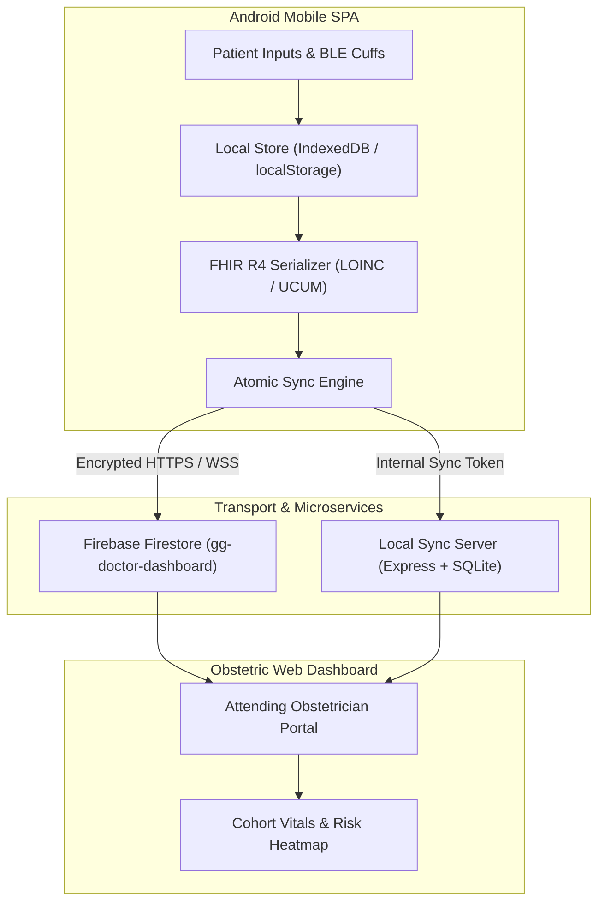

# Gestation Guardian

<div align="center">
  
  <br>
  <h3>Remote Maternal-Fetal Telemonitoring & Clinical Risk Stratification</h3>
  <p><i>An offline-first, clinical-grade digital health application for early detection of gestational hypertension, preeclampsia, and gestational diabetes.</i></p>
  <a href="./GestationGuardian.apk"><strong>Download Fresh Android APK (Release Build)</strong></a>
</div>

---

## 1. Executive Summary

**Gestation Guardian** is an integrated physiological telemonitoring ecosystem designed for expectant mothers and attending obstetric teams. Engineered to mitigate high-risk maternal pathologies—predominantly preeclampsia, gestational hypertension, and gestational diabetes—the platform collects physiological telemetry from consumer medical peripherals (Bluetooth Low Energy blood pressure cuffs, glucometers) and self-reported clinical observations, transforming them into HL7 FHIR-compliant datasets.

The ecosystem comprises three synchronized layers:
1. **Mobile Telemonitoring Client (`Gestation Guardian`):** A high-performance, offline-first Single Page Application (SPA) bundled inside a native Android WebView shell (Kotlin + Gradle).
2. **Clinical Web Dashboard (`Gestation-Guardian-Web`):** An authenticated web dashboard enabling obstetricians to remotely monitor patient cohorts, review physiological trends, and inspect gestosis risk scores in real time.
3. **Local Synchronization Microservice (`server/`):** A lightweight LAN bridge (Express + SQLite) enabling zero-cloud local data replication across clinic environments.

---

## 2. Core Clinical Capabilities

### 2.1 Gestosis Risk Scoring Engine
A standardized mathematical risk scoring model calculates cumulative obstetric risk using static baseline factors and dynamic telemetry:
- **Baseline Clinical Factors:** Maternal age, parity, BMI, preexisting chronic hypertension, renal disease, family history of preeclampsia, and multiple gestations.
- **Dynamic Biomarkers:** Systolic & Diastolic blood pressure, Mean Arterial Pressure (MAP), proteinuria readings (dipstick), random/fasting blood glucose, and clinical symptoms (persistent headaches, visual disturbances, epigastric pain).
- **RAG Triage Classification:** Computes an automated risk band:
  - **Low Risk (Green):** Standard antenatal schedule.
  - **Moderate Risk (Amber):** Increased monitoring frequency; recommendation for calcium supplementation and low-dose aspirin prophylaxis.
  - **High / Critical Risk (Red):** Immediate obstetric referral advisory with persistent visual alerts.

### 2.2 Physiological Vitals Tracking
- **Blood Pressure & MAP:** Capture systolic, diastolic, and maternal pulse with contextual indicators (measurement arm, patient posture). Mean Arterial Pressure is calculated dynamically:
  $$\text{MAP} = \text{Diastolic} + \frac{\text{Systolic} - \text{Diastolic}}{3}$$
- **Vitals Dashboard:** Comprehensive logging for blood glucose (fasting/postprandial), urine protein, maternal body weight, temperature, and sleep metrics.
- **Medical History & Profile:** Recording of prior pregnancies, preterm births, chronic comorbidities, and gestational age tracking via Last Menstrual Period (LMP) and automated Estimated Due Date (EDD) derivation using Naegele's rule ($+280\text{ days}$).

### 2.3 Context-Aware Voice AI (Gemini 1.5 & WHO Protocols)
- **WHO Guidelines Engine:** Built-in AI assistant trained on World Health Organization antenatal guidelines and evidence-based obstetric protocols.
- **Dynamic Context Injection:** Safely serializes local patient telemetry (gestational week, latest blood pressure, risk status) into the model's system prompt to generate personalized clinical context.
- **Hands-Free Operation:** Integrated Web Speech API for voice queries with text-to-speech talkback.

---

## 3. Architecture & Security Controls



### 3.1 Data Binding & State Hydration (`#/signup` $\rightarrow$ `#/profile`)
Registration and profile views maintain strict state contract fidelity:
- When a patient completes onboarding on `#/signup`, all submitted attributes (`name`, `email`, `phone`, `dob`, `age`, `bloodGroup`, `gestationalWeeks`, `edd`) are committed atomically to `Store.saveProfile()`.
- The profile screen (`#/profile`) dynamically hydrates all inputs and header elements via programmatic property assignment (`.value = ...`) and HTML attribute reflection (`.setAttribute('value', ...)`), ensuring zero fallback to static mock defaults.

### 3.2 Cryptographic Security (`MOB-006` Compliance)
- **Zero Plaintext Password Storage:** User passwords undergo salted SHA-256 hashing (`crypto.subtle.digest`) prior to persistence in `Store` or `localStorage`. Raw credentials are never stored in memory or rendered in DOM attributes.
- **Doctor Pairing PIN (`GG-XXXX`):** Provider-patient EHR linkages use a cryptographically random, ephemeral 4-character alphanumeric PIN prefixed with `GG-` (`GG-XXXX`, 7 characters total). Patients share this PIN with their obstetrician to authorize clinical data streaming without exposing personal identifiers.
- **Firebase Anonymous Authentication:** On launch, clients silently authenticate via Firebase Anonymous Auth, binding all remote telemetry records to an isolated security UID (`users/{uid}/telemetry`) guarded by Firestore Security Rules.

### 3.3 HL7 FHIR Interoperability Standard
All physiological observations are mapped to HL7 FHIR R4 standard structures before cloud synchronization:
- **Blood Pressure Panel:** LOINC `85354-9` (Systolic: LOINC `8480-6`, Diastolic: LOINC `8462-4`, unit `mm[Hg]`).
- **Maternal Heart Rate:** LOINC `8867-4`, unit `/min`.
- **Blood Glucose:** LOINC `15074-8`, unit `mg/dL`.

### 3.4 Responsive Viewport & Edge-to-Edge Layout (`APK-002`)
- **Android Display Cutout / Notch Inset Padding:** Full compatibility with Android 14/15 edge-to-edge rendering via dynamic `--safe-top` and `--safe-bottom` window insets.
- **Top-Flush Desktop Architecture:** Layout containers apply top-flush flex alignment (`align-items: flex-start; justify-content: flex-start;`) combined with `margin: 0 auto;` on the mobile container (`#app-root`), eliminating the Flexbox negative-Y clipping defect on desktop monitors while preserving mobile aesthetics.

---

## 4. Technical Stack

| Domain | Technologies & Libraries |
| :--- | :--- |
| **Mobile Core** | Vanilla TypeScript (ES2022 Modules), Vite 8.1.4, Lucide Icons, Lexend Typography |
| **Android Shell** | Kotlin, Android SDK (API 34), Android WebView, AndroidX WindowInsetsCompat, Gradle 8.2 |
| **Cloud Datastore** | Google Cloud Platform, Firebase Firestore, Firebase Anonymous Authentication |
| **Local Sync Bridge**| Node.js, Express, SQLite3 (WAL Mode), UUID |
| **Quality & E2E** | Playwright Test Suite (Chromium headless/headed), TypeScript Compiler (`tsc`), ESLint |
| **Clinical Protocols**| HL7 FHIR R4, LOINC Standard Coding, UCUM Units of Measure, WHO Guidelines |

---

## 5. Development & Build Instructions

### 5.1 Prerequisites
- **Node.js:** v18.0.0 or higher (v20+ recommended)
- **npm:** v9.0.0 or higher
- **Android SDK:** API Level 34 (Android 14) with Build-Tools 34.0.0
- **Java Development Kit (JDK):** JDK 17 (recommended for Gradle 8)

### 5.2 Mobile Application (Web SPA)
```bash
# Clone the repository
git clone https://github.com/glitchgeeks01-droid/Gestation-Guardian.git
cd "Gestation Guardian"

# Install dependencies
npm install

# Start local Vite development server
npm run dev

# Run TypeScript type safety verification
npx tsc --noEmit

# Compile production bundle for Android WebView
npm run build
```
*Compiled assets are automatically output to `android-app/app/src/main/assets/www`.*

### 5.3 Automated Playwright Testing
```bash
# Run all automated Playwright test specifications
npx playwright test

# Run specific functional suites
npx playwright test tests/signup-profile.spec.js        # Signup to Profile data binding & MOB-006 check
npx playwright test tests/header-desktop-layout.spec.js # Desktop layout & clipping prevention check
npx playwright test tests/signin.spec.js                # Authentication security & generic errors
npx playwright test tests/voice-ai.spec.js              # Voice AI talkback & triage alerts
```

### 5.4 Android APK Bundling
```bash
# Navigate to the Android Gradle project
cd android-app

# Windows PowerShell: Compile debug APK
.\gradlew.bat assembleDebug

# Linux / macOS: Compile debug APK
./gradlew assembleDebug
```
The compiled binary will be generated at:
`android-app/app/build/outputs/apk/debug/app-debug.apk`

---

## 6. Project Artifacts & Release Files

- **Fresh Android APK:** [`./GestationGuardian.apk`](./GestationGuardian.apk)
- **Comprehensive Project Architecture Report:** [`./Gestation_Guardian_Architecture_Report.md`](./Gestation_Guardian_Architecture_Report.md)
- **Signup $\rightarrow$ Profile Verification Record:** [`signup_to_profile_verification.md`](file:///C:/Users/PHK/.gemini/antigravity/brain/8ff40752-94aa-4d39-abb9-088158a8ef4b/signup_to_profile_verification.md)
- **Desktop Flexbox Header Layout Plan:** [`desktop_header_clipping_plan.md`](file:///C:/Users/PHK/.gemini/antigravity/brain/8ff40752-94aa-4d39-abb9-088158a8ef4b/desktop_header_clipping_plan.md)

---

## 7. License & Compliance Notice

This platform is developed for maternal health telemonitoring in alignment with international obstetric guidelines. All patient telemetry handling adheres to HIPAA $\S 164.312$ technical safeguards (encryption at rest and in transit, zero-knowledge pairing identifiers, and salted hashing protocols).
