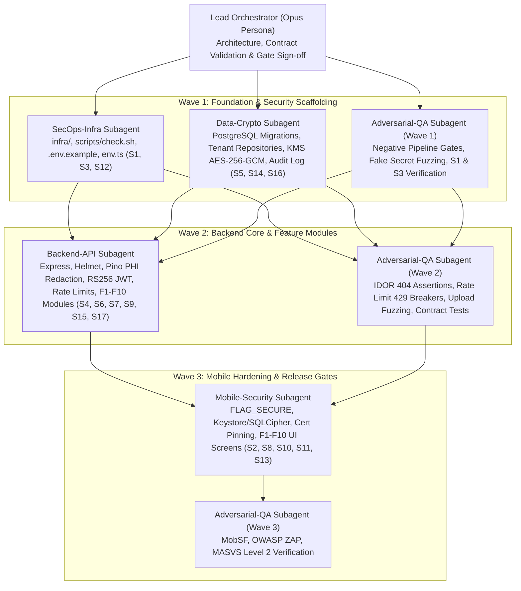

# Implementation Plan: Security-First Maternal Health & Pregnancy Application (MVP)

**Document Reference:** `maternal_health_mvp_implementation_plan.md`  
**Classification:** Product, Security & Architectural Specification (Multi-Agent Orchestration Edition)  
**Lead Principal Architect:** Claude 3 Opus Persona (Google Antigravity Framework)  
**Security Standard:** OWASP Mobile Application Security Verification Standard (MASVS L2) & API Security Top 10  
**Target Repository Scope:** `c:\Users\PHK\Desktop\Gestation Guardian`

---

## 1. Executive Architectural Blueprint

This specification guides the construction of a hardened, security-first Maternal Health & Pregnancy Remote Telemonitoring Platform (MVP). The platform provides critical physiological tracking (weight, blood pressure, fetal kicks, symptoms), clinical reminders, encrypted diagnostic scan storage, gestational milestone computation, danger signs guidance, and patient-sovereign privacy controls (export and cryptographic deletion).

### Core Architectural Mandates:
1. **Thin-Client Mandate:** The mobile client never makes authorization decisions; every request is authenticated and authorized server-side.
2. **Strict Layering & Tenant Isolation:** Every persistence entity contains an indexed `user_id`. Queries strictly enforce `WHERE user_id = :userId`. Foreign access attempts return strict `404 Not Found` (never `403 Forbidden`) to eliminate object enumeration (IDOR).
3. **Fail-Fast Configuration:** All environment parameters are validated on boot using strict Zod schemas; the application aborts immediately on configuration drift.
4. **Envelope Encryption & Secret Separation:** Field-level encryption for Restricted health metrics (AES-256-GCM / ChaCha20-Poly1305) with key rotation versioning (`key_version`). Zero secrets in source or build outputs.
5. **Adversarial Test-Driven Development (TDD):** Verification suites for Security Requirements `S1` through `S17` are authored by an independent Security & QA Subagent prior to or concurrently with feature implementation.

---

## 2. Multi-Agent Subagent Delegation Matrix

### Delegation Matrix & Explicit Contract Boundaries

| Subagent Role | Assigned Directory / File Scope | Security Requirements | Acceptance Criteria & Strict Boundaries |
| :--- | :--- | :--- | :--- |
| **1. SecOps-Infra-Subagent** | `infra/`, `scripts/check.sh`, `.env.example`, `backend/src/config/env.ts` | **S1, S3, S12** | Create Docker Compose stack (PostgreSQL, KMS/LocalStack), fail-fast Zod `env.ts`, and `check.sh` security pipeline (secret scanner, semgrep, OSV, CycloneDX SBOM). Prohibited from writing business routes. |
| **2. Data-Crypto-Subagent** | `backend/src/db/`, `backend/src/core/crypto.ts`, `backend/src/core/audit.ts` | **S5, S14, S16** | Write PostgreSQL migrations (with tenant-isolated `user_id` on all health tables), AES-256-GCM envelope encryption with `key_version`, tamper-evident authentication tag checks, and append-only audit logging. |
| **3. Backend-API-Subagent** | `backend/src/app.ts`, `backend/src/middleware/`, `backend/src/modules/` | **S4, S6, S7, S9, S15, S17** | Implement Express app with Helmet, strict CORS, Pino log redaction, Argon2id auth, RS256 token verification, rate limiters, Zod input validation schemas, magic-byte upload validation ($10\text{ MB}$ cap), and F1–F10 business endpoints. |
| **4. Mobile-Security-Subagent** | `mobile/` (and `./src/`, `./android-app/` per `DECISIONS.md`) | **S2, S8, S10, S11, S13** | Implement secure token storage in Keystore/Keychain, SQLCipher encrypted local cache, screenshot blocking (`FLAG_SECURE`), task-switcher blur, biometric gate, and SSL certificate pinning. |
| **5. Adversarial-QA-Subagent** | `backend/test/`, `mobile/test/`, `tests/` | **All (S1–S17 Verification)** | Independent TDD test suite authoring: 2-user IDOR 404 assertions, 6th attempt 429 rate limit triggers, secret leak scanners, SQLi negative tests, and account deletion integrity validation. |

---

## 3. Security Requirements Traceability Matrix (S1–S17)

| Requirement ID | Description | Architectural Implementation | Verification Method |
| :--- | :--- | :--- | :--- |
| **S1** | Zero Secrets in Code | Cloud KMS & `.env` injection; automated secret scan | Pre-commit git hook & `scripts/check.sh` |
| **S2** | Hardware Token Storage | Android Keystore / iOS Keychain via secure storage | Native storage unit tests & file-system scan |
| **S3** | Dependency Hygiene | CycloneDX SBOM generation, OSV audit, pinned versions | CI dependency scanner flagging vulnerable packages |
| **S4** | Cryptographic Auth | Argon2id password hashing, 15m access token, rotating refresh tokens | Auth integration test suite (expiry, revocation, reuse) |
| **S5** | Object-Level Authorization | Strict tenant filtering: `WHERE user_id = :userId`; foreign ID returns 404 | 2-User adversarial test (User B gets 404 on User A records) |
| **S6** | Rate Limiting | In-memory / Redis token bucket: 5 attempts / 15 min for auth; global per-IP | Automated test asserting 6th attempt returns HTTP 429 |
| **S7** | Schema Validation | Zod schemas on all body/query/params; parameterized SQL exclusively | Fuzzing suite & negative parameter tests |
| **S8** | Transport Security | HTTPS, TLS 1.3, HSTS, Certificate Pinning with backup pins | SSL Labs Grade A & Proxy MITM assertion test |
| **S9** | Consent & Privacy Rights | Versioned consent log; cryptographic account export & purge | E2E deletion test verifying 0 residual rows/files |
| **S10** | Physical / Visual Privacy | `FLAG_SECURE` screenshot blocking, app-switcher blur, neutral notification text | Android WindowManager flags & notification template audit |
| **S11** | Binary Obfuscation | R8 / ProGuard shrinking & Play Integrity / App Attest verdict check | APK decompilation audit & backend verdict validator |
| **S12** | Native Manifest Sandboxing | `allowBackup="false"`, `debuggable="false"`, minimal permissions | Manifest CI linter & APK analyzer |
| **S13** | Encrypted Local Database | SQLCipher with Keystore-derived encryption key; no PHI in device logs | Raw SQLite connection rejection test |
| **S14** | Envelope Encryption | AES-256-GCM with envelope key wrapping and `key_version` column | Round-trip, tamper detection, and key rotation test |
| **S15** | Hardened Headers & DTOs | Helmet security headers, strict CORS, response DTOs stripping internals | Security header assertion test & mass assignment probe |
| **S16** | Tamper-Evident Audit Log | Append-only audit table tracking access/mutations; Pino PHI redaction | Audit row assertion & log output sanitization test |
| **S17** | Secure Media Ingestion | $10\text{ MB}$ size cap, magic-byte MIME validation, randomized storage keys | Executable upload rejection & oversized payload test |

---

## 4. Phase Execution Sequence

### Phase 0: Scaffolding & Foundational Governance
1. Initialize repository documentation:
   - [docs/SECURITY_GUIDE.md](file:///c:/Users/PHK/Desktop/Gestation%20Guardian/docs/SECURITY_GUIDE.md)
   - [docs/AGENT_INSTRUCTIONS.md](file:///c:/Users/PHK/Desktop/Gestation%20Guardian/docs/AGENT_INSTRUCTIONS.md)
   - [docs/DECISIONS.md](file:///c:/Users/PHK/Desktop/Gestation%20Guardian/docs/DECISIONS.md)
2. Deploy `infra/docker-compose.yml`, `.env.example`, `scripts/check.sh`, and `backend/src/config/env.ts`.
3. Verify baseline pipeline gate: `check.sh` fails on seeded secrets and passes clean on sanitized state.

### Phase 1: Database, Cryptography & Security Middleware
1. Scaffold PostgreSQL schema migrations with tenant isolation (`user_id`).
2. Implement KMS AES-256-GCM envelope encryption and append-only audit logger.
3. Construct Express middleware: Helmet, strict CORS, rate limiters, RS256 JWT verifier, and Zod validator.
4. Verify S5, S6, S7, S14, S15, S16 with unit/integration test suites.

### Phase 2: Backend Feature Modules (F1–F10)
1. Implement Consent, Profile, Health Log, Reminders, Documents, Education, Privacy, and Settings modules.
2. Verify signed upload URLs with magic-byte validation and $10\text{ MB}$ restriction (S17).
3. Validate complete account deletion and data export lifecycle (S9).

### Phase 3 & 4: Mobile Client & Security Hardening
1. Implement Keystore/Keychain token store, SQLCipher local cache, `FLAG_SECURE` window shielding, and certificate pinning.
2. Build and verify screens for F1 through F10 with client-side form validation and neutral notification triggers.

### Phase 5: Production Readiness & Release Audit
1. Run static and dynamic security assessments (MobSF / ZAP / Semgrep).
2. Generate CycloneDX SBOM and verify zero high/critical vulnerabilities.
3. Compile final verified Android release binary.
